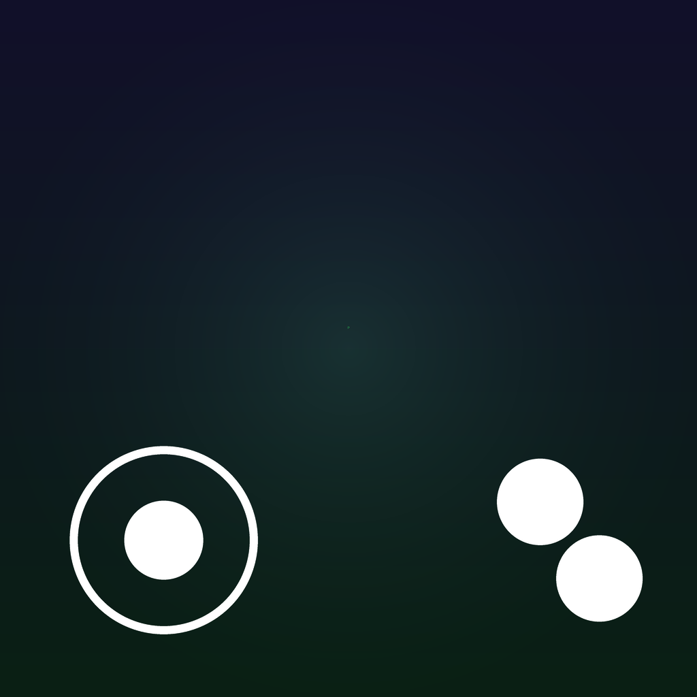

<p align="center">
  
  <h1 align="center">Pemozone</h1>
  <p align="center">An iOS and iPadOS Minecraft: Java Edition client with a focus on touch controls</p>
  <p align="center">
    
    
    
    <a href="LICENSE"></a>
  </p>
  <p align="center">
    <a href="#building-and-installing-on-ios"><b>Build for iOS</b></a> ·
    <a href="./BUILDING.md"><b>Building</b></a> ·
    <a href="#credits-and-acknowledgements"><b>Credits</b></a> ·
    <a href="./THIRD_PARTY_LICENSES.md"><b>Licenses</b></a>
  </p>
</p>

---

## What Pemozone is

Pemozone is an independent, community-built **Minecraft: Java Edition client for
iPhone and iPad (iOS/iPadOS 16 and later)**. It connects to vanilla Java Edition
servers and, like the engine underneath it, contains no Mojang code.

Pemozone is built on the **Pomme Rust engine** — a high-performance Minecraft
client written from scratch in Rust, rendering through Vulkan (MoltenVK on
Apple platforms). Pemozone takes that engine and focuses its work on the mobile
experience: a touch-control system that you can arrange, resize and fade to suit
the way you play.

> [!IMPORTANT]
> Pemozone is an **independent community project**. It is **not** an official
> release of Pomme, and it is **not** affiliated with, endorsed by, or produced
> by the Horizon project. Pemozone reuses and adapts open-source code from both;
> the credits and licenses below say exactly what came from where.

## Why Pemozone exists

Playing Minecraft: Java Edition on a phone or tablet has always meant
compromising on input. Vanilla's mobile story lives on Bedrock, not Java, and the
Java clients that do run on iOS tend to ship a fixed set of on-screen buttons
that you cannot move, cannot resize, and cannot see through when the screen gets
busy.

Pemozone exists to close that gap for Java Edition on iOS:

- **A layout you control.** Every touch control can be moved, resized and faded,
  with a live editor that shows the result as you change it.
- **Controls that survive restarts.** Your layout is saved and restored, so you
  set it up once.
- **A control scheme designed for touch first.** The interaction model is
  inspired by the concepts explored in [Horizon iOS](https://github.com/Kelly-Inc/horizon-ios),
  a separate MIT-licensed Minecraft Java client for iOS.

## Technical foundation

Pemozone does **not** contain a new engine. Its client, renderer, protocol
layer, networking, audio and world logic come from the **Pomme engine**
(GPL-3.0-or-later). Pemozone's own contribution is concentrated in the mobile
touch layer and the iOS packaging around it.

```
┌──────────────────────────────────────────────────────────────┐
│                        Pemozone (this repo)                    │
│  iOS/iPadOS app  ·  touch layout + editor  ·  packaging        │
├──────────────────────────────────────────────────────────────┤
│                    Pomme engine  (GPL-3.0-or-later)            │
│  Rust client core · renderer (Vulkan/MoltenVK) · protocol ·    │
│  networking · audio (OpenAL Soft) · singleplayer (SteelMC)     │
├──────────────────────────────────────────────────────────────┤
│  Upstream Rust crates: azalea · ash · winit · naga · glam · …  │
└──────────────────────────────────────────────────────────────┘
```

The touch-layout **design** (data-driven placements, normalized coordinates, and
the drag/resize/fade editor) follows the MIT-licensed touch layout and editor in
Horizon iOS. The Pemozone implementation is written in this repository and keeps
Horizon's MIT notice — see [Credits](#credits-and-acknowledgements) and
[THIRD_PARTY_LICENSES.md](./THIRD_PARTY_LICENSES.md).

## Features

These are the capabilities present in the code at this version. See
[Development status and limitations](#development-status-and-limitations) for
what has and has not been verified on real hardware.

1. **Customizable touch-control layout** — the on-screen joystick and action
   buttons are data, not fixed constants, so each control can be placed
   independently.
2. **Dragging and resizing touch controls** — a full-screen **Touch Layout**
   editor (Options → Controls → Touch Layout) previews the live controls and lets
   you drag one to move it, select it, and adjust its size and opacity, plus a
   global size.
3. **Touch layout persistence** — the layout is written to `touch_layout.json`
   next to the other settings and restored on the next launch, atomically, so an
   interrupted save cannot corrupt it.
4. **Inventory and container closing behavior** — a touch player can close the
   inventory, a container or the creative screen from the same corner that opens
   them; Escape and `Action::Close` route through the same per-screen close path.
5. **Optional built-in resource packs** — vanilla's optional built-in packs
   (for example `programmer_art` and `high_contrast`) are discovered from the
   installation's asset index and offered on the resource-pack screen, with their
   enabled/disabled state kept across reloads.
6. **Audio support** — vanilla sound events, music and subtitles through
   OpenAL Soft, embedded as `soft_oal.framework` on iOS.
7. **Shader compatibility** — the renderer loads shader packs, with the
   per-version program set and the sky/horizon stages that packs rely on.
8. **Multiplayer and local-network permissions** — the iOS app declares the
   local-network usage description and allows local networking, so a LAN world
   or a self-hosted server can be reached and the system prompt appears.
9. **ProMotion support** — the iOS app opts out of the default 60 Hz minimum
   frame duration on ProMotion displays (iPhone 13 Pro and later, iPad Pro), so
   higher frame-rate settings can be reached where the display supports them.

## Supported platforms and Minecraft versions

| Area | Support | How it was verified |
| --- | --- | --- |
| Platform | iOS 16+ / iPadOS 16+, **arm64** | iOS deployment target and `ARCHS: arm64` in `pomme-ios/project.yml` |
| Devices | iPhone and iPad (`TARGETED_DEVICE_FAMILY = 1,2`) | `pomme-ios/project.yml` |
| Rendering | Vulkan via MoltenVK (static) | `pomme-ios/build-app.sh`, `tools/fetch_moltenvk.py` |
| Minecraft | **1.20 through 26.3**; native wire version **26.2** (protocol 776) | `pomme-protocol/src/version.rs` (`VERSIONS`, `NATIVE`, `TRANSLATED`) |
| Audio | OpenAL Soft | `tools/build_openal.py`, `pomme-client/src/audio` |

Other listed Java versions are joined by translating their wire format to 26.2;
`pomme-protocol`'s `joinable()` decides which a server may speak. The desktop
build of the same engine also targets Windows, macOS and Linux, but Pemozone's
focus and packaging are iOS/iPadOS.

## Building and installing on iOS

An unsigned IPA built by GitHub Actions is published on this repository's
[Releases](../../releases) page. It is **unsigned** — to run it on a device you
must sign it with your own Apple Developer team (or build from source), which
also means the first install is a manual, sideloading-style step rather than an
App Store install.

### Build from source

Requirements: macOS with Xcode, plus:

```sh
brew install xcodegen cmake
rustup target add aarch64-apple-ios aarch64-apple-ios-sim
```

Generate the Xcode project from `pomme-ios/project.yml` and build:

```sh
cd pomme-ios && xcodegen generate
```

Then, with your Apple Developer team id (Membership on developer.apple.com, or
Xcode → Settings → Accounts):

```sh
just ios-device <team-id>     # build, sign, install and run on a paired device
just ios-sim                  # the booted simulator (starts, cannot render yet)
just ios-archive <team-id>    # Release archive and an App Store .ipa
```

The first build downloads MoltenVK and compiles OpenAL Soft; on first launch the
app downloads the game's assets (about 500 MB) or you can push a desktop
install's assets with `just ios-push-assets`. See
[pomme-ios/README.md](./pomme-ios/README.md) and [BUILDING.md](./BUILDING.md) for
the full detail, including the `launch.txt` flags the app reads.

### Continuous integration

`.github/workflows/ios-build.yml` builds an unsigned IPA on a macOS runner
(`xcodebuild`, `CODE_SIGNING_ALLOWED=NO`) and attaches it to a build release. It
also runs on demand via **workflow_dispatch**.

## Development status and limitations

Pemozone is in **active, early development**. Treat it as a work in progress.

- **Device testing.** The code in this repository has been **reviewed and covered
  by automated tests**, and the iOS app is built by CI, but the touch-layout and
  the ProMotion / local-network changes have **not been verified on a physical
  iPad or iPhone** by this project. Do not assume a feature works on a device
  until it has been tested on one.
- **Signing.** CI produces an **unsigned** IPA; it will not install until it is
  signed with your own team.
- **Simulator.** The iOS simulator builds and starts but **cannot render**: its
  GPU lacks `drawIndirectFirstInstance`, which the chunk renderer needs. Use a
  device.
- **Singleplayer.** The integrated server (SteelMC) is compiled in for the
  client, but the mobile build follows the mobile configuration; verify
  singleplayer behavior on your target before relying on it.
- **HUD safe area.** The HUD does not yet account for the notch and rounded
  corners, so its edges can be covered on some devices.
- **Minecraft versions.** Joined versions are limited to those with a complete
  wire translation to the native 26.2 protocol.

## Credits and acknowledgements

Pemozone would not exist without these projects. Full license texts and notices
are in [THIRD_PARTY_LICENSES.md](./THIRD_PARTY_LICENSES.md).

- **Pomme** — the Rust Minecraft client engine Pemozone is built on.
  Source: <https://github.com/100ihrsmedmc/Client> (GPL-3.0-or-later).
  Pemozone is a derivative work of Pomme and keeps Pomme's GPL-3.0 license and
  copyright notices.
- **Horizon iOS** — Pemozone's touch-layout model and editor are adapted from
  concepts in Horizon's MIT-licensed touch layout.
  Source: <https://github.com/Kelly-Inc/horizon-ios> (MIT). Horizon's MIT notice
  is preserved.
- **SteelMC** — the embedded singleplayer server linked by `pomme-singleplayer`
  (AGPL-3.0-or-later).
- **azalea, ash, winit, naga, glam, gpu-allocator, binary-greedy-meshing,
  OpenAL Soft, MoltenVK, the Vulkan Loader** and the other crates and libraries
  listed in [THIRD_PARTY_LICENSES.md](./THIRD_PARTY_LICENSES.md).

Pemozone is an independent project and is not an official release of Pomme or
Horizon. Pemozone is not affiliated with or endorsed by Mojang Studios or
Microsoft. Minecraft is a trademark of Mojang Studios. Pemozone contains no
Mojang code; you must own Minecraft: Java Edition to sign in and play.

## License

Pemozone is distributed under the **GNU General Public License v3.0 or later**
(GPL-3.0-or-later), inherited from the Pomme engine it is built on. See
[LICENSE](./LICENSE). Because the client links SteelMC through
`pomme-singleplayer`, that crate is AGPL-3.0-or-later.

Corresponding source for every released binary is available in this repository
at the released tag.
